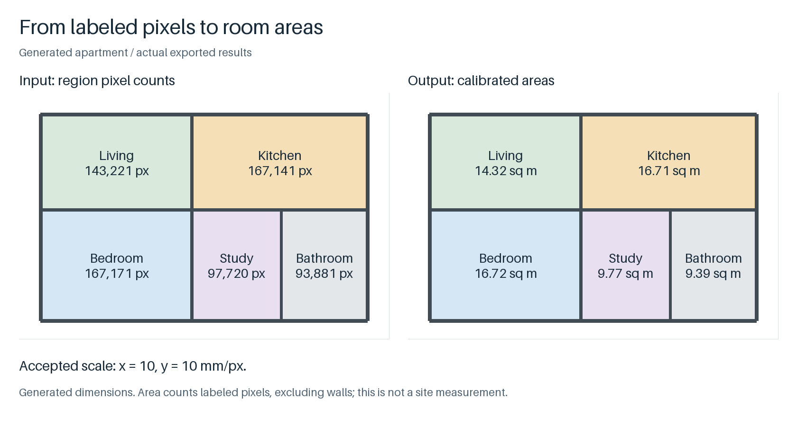

# PlanMetric

用图上的尺寸标注校准像素比例，再测墙线长度和房间面积。

[English](README.md) · [v0.2.0](https://github.com/crown-sports/planmetric/releases/tag/v0.2.0)



生成示例：比例尺采用 10 mm/px，客厅 **143,221 个像素换算为 14.32 m²**，墙体不计入，完整数值保留在 JSON 中。[运行这张示例](https://github.com/crown-sports/planportals/blob/main/docs/workflow.zh-CN.md)。

## 先试尺寸校准

Python 3.10+，不需要 GPU 或预训练模型。

```bash
python -m pip install "git+https://github.com/crown-sports/planmetric.git@v0.2.0"
planmetric demo --output runs/demo
```

原始输入与结果请分开放；重复使用同一个输出目录，会替换其中生成的结果文件。

打开 `runs/demo/evidence.svg` 和 `calibration.json`。这个独立校准示例故意放入了两条不一致的尺寸：


求解器接受 **8 组**、拒绝 **2 组**，两轴均得到 **10 mm/px**；给定的 320×250 px 矩形换算为 8 m²。

## 测自己的几何结果

按原图坐标提供尺寸文字框和尺寸线段，见[输入格式](docs/api.md)。

```bash
planmetric measure --observations /private/dimensions.json \
  --geometry runs/regions/regions.json --output runs/measurements.json
```

支持 [PlanRegions](https://github.com/crown-sports/planregions) 房间输出和 [WallGraph](https://github.com/crown-sports/wallgraph) 墙线输出。两份输入声明的图片尺寸必须一致。报告保留校准判断、输入摘要和测量结果。

房间面积按实例像素计数，保留孔洞的排除；墙长沿导出的中心线计算。x、y 两轴分别拟合，可以处理不等比例拉伸。测量所需的轴没有可用校准时，命令退出 **2**。

只需要校准时：

```bash
planmetric calibrate --observations /private/dimensions.json --output runs/result
```

## 从图片开始

单独安装 Tesseract 后，可运行图片适配器：

```bash
planmetric detect --image /private/plan.png --ocr tesseract \
  --default-unit mm --output runs/inspection
```

先检查它提出的文字和线段，再拿来测量。适配器会漏读、误读；上面的效果图都直接提供了标注观测。

如果多条尺寸一起错得很一致，仍可能得到被接受的错误比例。输出是给定几何的换算结果，不是实地测绘精度；墙体中心线长度也不是墙面工程量。[生成测试与已知失败](docs/validation.md)。

## 继续看

[实现说明](docs/product.md) · [API](docs/api.md) · [方法](docs/methods.md) · [架构](docs/architecture.md)

[贡献](CONTRIBUTING.md) · [发布检查](docs/releasing.md) · [安全报告](SECURITY.md)

代码与原创生成图使用 MIT 许可，不包含真实图纸、标注或模型权重。[来源说明](NOTICE.md)。
