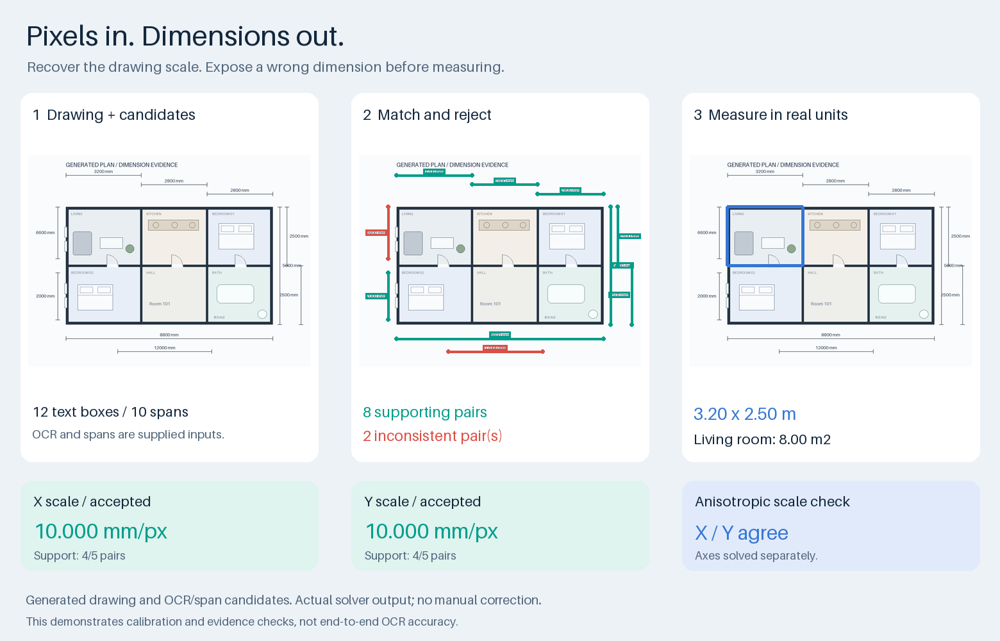

# PlanMetric

**把图纸像素换成长度和面积，每个比例尺都有据可查。**

[English](README.md) · [发布版本](https://github.com/crown-sports/planmetric/releases)



图中尺寸文字框和标注线由程序生成。实际求解器采用 **8 组尺寸**、剔除 **2 组不一致尺寸**，得到横纵均为 **10 毫米/像素**。320×250 像素的房间换算为 **3.20×2.50 米，8.00 平方米**。这张图展示校准效果，OCR 候选是已提供的输入。

## 运行一下

Python 3.10 或更新版本，无需 GPU 或预训练模型。

```bash
python -m pip install "git+https://github.com/crown-sports/planmetric.git@v0.1.0"
planmetric demo --output runs/demo
```

CLI 输出校准报告与几何叠加图，可检查采用了哪些尺寸。

```bash
planmetric calibrate --observations /private/dimensions.json --output runs/result
```

直接检查图片时，另行安装 Tesseract 及所需语言数据：

```bash
planmetric detect --image /private/plan.png --ocr tesseract \
  --default-unit mm --output runs/inspection
```

图像适配器提取文字和正交尺寸线候选，也会漏读、错配；接入自己的 OCR 框和尺寸线，更方便控制输入与复核。[输入格式与 API](docs/api.md)。

## 能帮你完成什么

| 问题 | 输出 |
| --- | --- |
| 墙线、房间轮廓只有像素坐标 | 按有效标定换算长度和面积 |
| 某个尺寸被读错 | 每条尺寸的残差、采用或拒绝原因 |
| 图片横纵缩放不一致 | 分别求横纵比例尺，并标出拉伸 |
| 单位缺失、尺寸不足或互相矛盾 | 返回不完整或冲突状态，不编造比例尺 |

可接 [WallGraph](https://github.com/crown-sports/wallgraph) 和 [PlanRegions](https://github.com/crown-sports/planregions) 的原图坐标几何。保留图纸和测量叠加图，方便使用者复核。

## 技术与实测边界

一对一几何匹配 → 确定性 RANSAC 式比例假设 → 横纵分别拟合 → 检查条件后换算。重复来源的尺寸只计一次。[方法与出处](docs/methods.md) · [架构](docs/architecture.md)。

生成场景覆盖拒绝判断、少量错读、混合单位与横纵拉伸。**如果上游尺寸一致地读错，仍会得到错误且被接受的比例尺**；内部一致性无法证明全部输入都真实。评测保留这些失败，不作为真实图纸 OCR 准确率宣传。[完整实验](docs/validation.md)。

## 开发

```bash
python -m pip install -e '.[dev]'
pytest
python tools/render_demo.py --check
python tools/release.py --check
```

[贡献](CONTRIBUTING.md) · [安全报告](SECURITY.md) · [下载内容](docs/releasing.md)

代码使用 MIT。唯一图片是程序生成的复合效果图；真实图纸、标注、数据集和权重不随项目发布。[来源说明](NOTICE.md)。

## 批量测量墙线与房间

源码版新增 `planmetric measure --observations /private/dimensions.json --geometry runs/regions/regions.json --output runs/measurements.json`。
支持 PlanRegions 精确像素面积和 WallGraph 折线路径，校验原图尺寸，保留校准证据与输入摘要。
不同 x/y 比例分别计算；所需坐标轴校准未通过时返回错误，不猜测物理尺寸。
